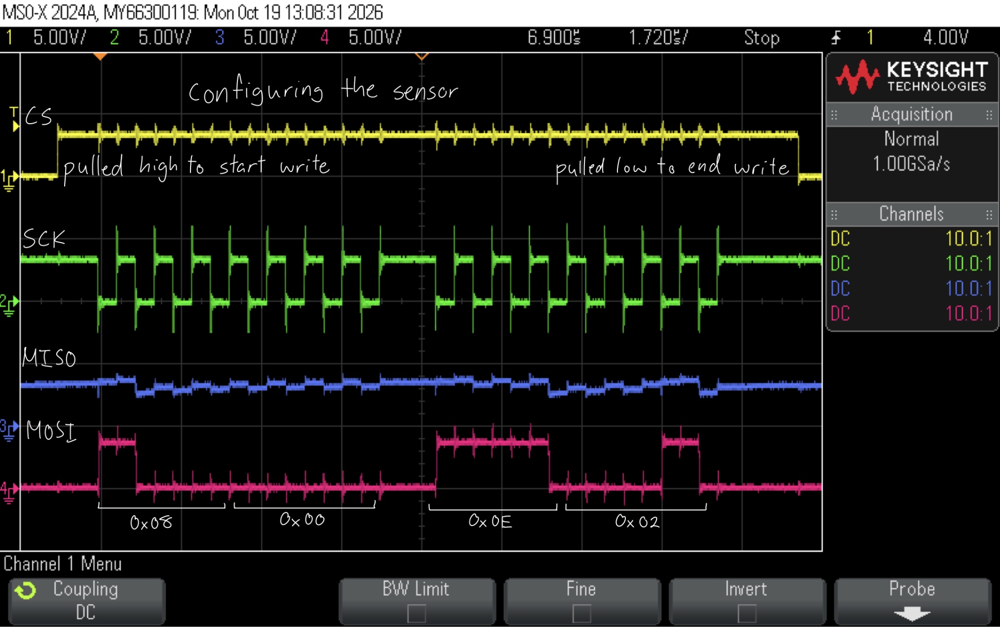
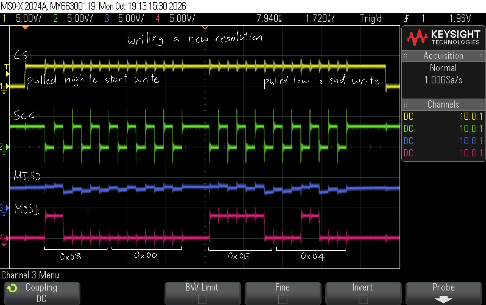
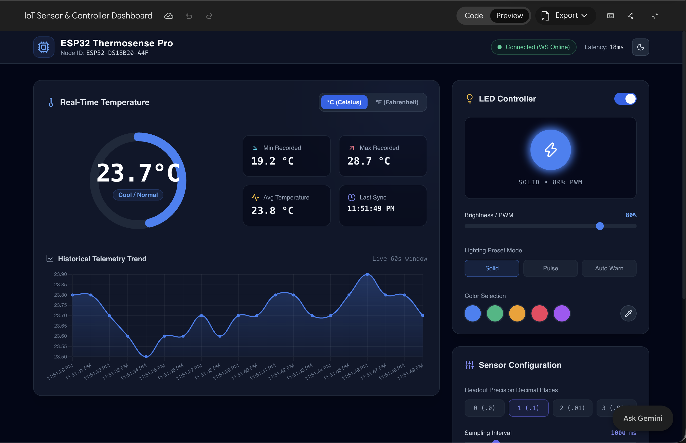

## Introduction
In this lab, a design was implemented on the MCU to host a web server on an ESP8266 through UART communication and read temperature readings of various resolutions using a temperature sensor through SPI communication. Data from the peripherals connected to the MCU would be displayed on the webpage.

## Design and Testing Methodology

On the MCU, SPI was configured for full-duplex communication. This was chosen over simplex communications because apart from receiving temperature readings from the sensor, the MCU would have to write to the configuration register throughout deployment to adjust the resolution of the temperature communicated. It was also chosen over half-duplex communication to increase the speed the devices could communicate at, which would lead to more accurate readings.

The temperature sensor used (DS1722) required a clock phase (CPHA) of 1. I chose to use a clock polarity (CPOL) of 1 so that data would be sampled on the rising edge of SCK.

Full-duplex SPI communication works by each device sending and receiving bits at the same time. So, for writing to the temperature sensor (ex. for writing the initial configuration and for writing new resolution bits), I would write the entire configuration and receive junk in return (that I wouldn't use). For reading temperatures from the sensor, I would write junk bits to the sensor and receive the temperature bits in return. Because of how the temperature sensor registers were configured, I would read the integer bits and decimal bits separately.

The MCU and ESP8266 interface through a 125000 baud serial UART connection on TX and RX lines. Because of this, to prevent sampling differences, the MCU and temperature sensor baud rate was also set to 125000.

HTML code was written so that the temperature and LED data could be properly displayed on the webpage, and users could press buttons to toggle the LED state and change the temperature resolution.

## Technical Documentation
The source code for the project can be found in the associated [GitHub repository](https://github.com/natalieko2024/E155-Labs/tree/main/E155-Lab6).

### Schematic


The schematic in Figure 1 shows the physical circuit connections outside the PCB. The ESP8266 was not included as that was plugged directly into the motherboard.

## Results and Discussion
The design met all intended design objectives.

### Hardware Deployment
This video showcases the design webpage outputs and LED states when each button is pressed. The LED state matches the LED on/off in real life, and the maximum number of decimal values the temperature sensor displays matches the selected resolution.



### Oscilloscope Confirmation

:::{layout-ncol="2"}




:::

These oscilloscope traces confirm the intended SPI behaviour during configuration, read, and write. CS was pulled high during read/write and pulled low otherwise, and the correct values were transmitted over MISO and MOSI.

## Conclusion
The design successfully utilized SPI and UART.

I spend 8.5 hours working on this lab.

## AI Prototype Summary

::: {.callout-note collapse="true"}
## Click to view LLM output for prompt 1
```{html}
<!DOCTYPE html>
<html lang="en" class="dark">
<head>
    <meta charset="UTF-8">
    <meta name="viewport" content="width=device-width, initial-scale=1.0">
    <title>IoT Sensor & LED Controller Dashboard</title>
    <!-- Tailwind CSS CDN -->
    <script src="https://cdn.tailwindcss.com"></script>
    <script>
        tailwind.config = {
            darkMode: 'class',
            theme: {
                extend: {
                    colors: {
                        darkBg: '#0b0f19',
                        cardBg: '#111827',
                        cardBorder: '#1f2937',
                        accentBlue: '#3b82f6',
                        accentTeal: '#14b8a6',
                    },
                    fontFamily: {
                        sans: ['Inter', 'sans-serif'],
                    }
                }
            }
        }
    </script>
    <!-- Chart.js CDN -->
    <script src="https://cdn.jsdelivr.net/npm/chart.js"></script>
    <!-- Lucide Icons CDN -->
    <script src="https://unpkg.com/lucide@latest"></script>
    <style>
        /* Custom scrollbar for terminal/console */
        ::-webkit-scrollbar {
            width: 6px;
            height: 6px;
        }
        ::-webkit-scrollbar-track {
            background: #0d1117;
        }
        ::-webkit-scrollbar-thumb {
            background: #21262d;
            border-radius: 4px;
        }
        ::-webkit-scrollbar-thumb:hover {
            background: #30363d;
        }
        /* Radial Gauge Gradient & Animation */
        .gauge-circle {
            transition: stroke-dashoffset 0.5s ease, stroke 0.5s ease;
        }
        /* LED Glow Effect */
        .led-glow {
            transition: all 0.3s cubic-bezier(0.4, 0, 0.2, 1);
        }
        @keyframes pulse-slow {
            0%, 100% { opacity: 1; transform: scale(1); }
            50% { opacity: 0.4; transform: scale(0.96); }
        }
        .animate-led-pulse {
            animation: pulse-slow 2s cubic-bezier(0.4, 0, 0.6, 1) infinite;
        }
    </style>
</head>
<body class="bg-slate-950 text-slate-100 font-sans min-h-screen flex flex-col antialiased selection:bg-blue-500 selection:text-white">

    <!-- Top Navigation Header -->
    <header class="border-b border-slate-800 bg-slate-900/80 backdrop-blur-md sticky top-0 z-50">
        <div class="max-w-7xl mx-auto px-4 sm:px-6 lg:px-8 h-16 flex items-center justify-between">
            <div class="flex items-center gap-3">
                <div class="p-2 bg-blue-500/10 border border-blue-500/20 rounded-xl text-blue-400">
                    <i data-lucide="cpu" class="w-6 h-6"></i>
                </div>
                <div>
                    <h1 class="text-lg font-bold tracking-wide text-white leading-tight">ESP32 Thermosense Pro</h1>
                    <p class="text-xs text-slate-400">Node ID: <span class="font-mono text-slate-300">ESP32-DS18B20-A4F</span></p>
                </div>
            </div>

            <!-- Header Connection Info & Quick Toggles -->
            <div class="flex items-center gap-4">
                <div class="hidden sm:flex items-center gap-2 px-3 py-1.5 rounded-full bg-emerald-950/40 border border-emerald-500/30 text-emerald-400 text-xs font-medium">
                    <span class="w-2 h-2 rounded-full bg-emerald-400 animate-ping"></span>
                    <span class="w-2 h-2 rounded-full bg-emerald-400 -ml-4"></span>
                    <span id="connection-status-text">Connected (WS Online)</span>
                </div>
                <div class="text-xs text-slate-400 hidden md:block">
                    Latency: <span id="ping-latency" class="font-mono text-slate-200">18ms</span>
                </div>
                <button id="theme-toggle" class="p-2 rounded-lg bg-slate-800 hover:bg-slate-700 text-slate-300 transition-colors border border-slate-700" title="Toggle Light/Dark Theme">
                    <i data-lucide="moon" class="w-4 h-4" id="theme-icon"></i>
                </button>
            </div>
        </div>
    </header>

    <!-- Main Container -->
    <main class="flex-1 max-w-7xl w-full mx-auto p-4 sm:p-6 lg:p-8 space-y-6">

        <!-- Grid Layout for Dashboard Cards -->
        <div class="grid grid-cols-1 lg:grid-cols-12 gap-6">

            <!-- LEFT COLUMN: Temperature Section (8 cols) -->
            <div class="lg:col-span-8 space-y-6">

                <!-- Main Temperature Readout Card -->
                <div class="bg-slate-900 border border-slate-800 rounded-2xl p-6 shadow-xl relative overflow-hidden">
                    <div class="absolute -right-16 -top-16 w-64 h-64 bg-blue-500/5 rounded-full blur-3xl pointer-events-none"></div>

                    <!-- Card Header -->
                    <div class="flex flex-wrap items-center justify-between gap-4 mb-6">
                        <div class="flex items-center gap-2">
                            <i data-lucide="thermometer" class="w-5 h-5 text-blue-400"></i>
                            <h2 class="font-semibold text-slate-200 text-base">Real-Time Temperature</h2>
                        </div>
                        
                        <!-- Unit Toggle Button Group -->
                        <div class="bg-slate-800/80 p-1 rounded-xl border border-slate-700/60 flex items-center gap-1 text-xs font-semibold">
                            <button id="btn-celsius" onclick="setUnit('C')" class="px-3 py-1.5 rounded-lg bg-blue-600 text-white shadow-sm transition-all">°C (Celsius)</button>
                            <button id="btn-fahrenheit" onclick="setUnit('F')" class="px-3 py-1.5 rounded-lg text-slate-400 hover:text-slate-200 transition-all">°F (Fahrenheit)</button>
                        </div>
                    </div>

                    <!-- Gauge and Numeric Display -->
                    <div class="grid grid-cols-1 md:grid-cols-12 gap-6 items-center">
                        
                        <!-- Gauge SVG Graphic -->
                        <div class="md:col-span-6 flex flex-col items-center justify-center relative py-2">
                            <svg class="w-52 h-52 transform -rotate-90" viewBox="0 0 120 120">
                                <!-- Background Track -->
                                <circle cx="60" cy="60" r="50" class="stroke-slate-800" stroke-width="10" fill="transparent" />
                                <!-- Dynamic Gauge Fill Track -->
                                <circle id="gauge-circle" cx="60" cy="60" r="50" class="gauge-circle stroke-blue-500" stroke-width="10" 
                                        stroke-dasharray="314.15" stroke-dashoffset="150" stroke-linecap="round" fill="transparent" />
                            </svg>
                            <!-- Inner Readout Text -->
                            <div class="absolute flex flex-col items-center justify-center text-center">
                                <span id="temp-display" class="text-4xl sm:text-5xl font-black tracking-tight text-white font-mono">23.5°C</span>
                                <span id="temp-status-badge" class="mt-2 px-2.5 py-0.5 rounded-full text-xs font-semibold bg-blue-500/10 text-blue-400 border border-blue-500/20">
                                    Optimal Range
                                </span>
                            </div>
                        </div>

                        <!-- Temperature Meta Statistics -->
                        <div class="md:col-span-6 grid grid-cols-2 gap-4">
                            <div class="bg-slate-950/60 border border-slate-800/80 rounded-xl p-4">
                                <div class="flex items-center gap-2 text-slate-400 text-xs mb-1">
                                    <i data-lucide="arrow-down-right" class="w-4 h-4 text-cyan-400"></i>
                                    Min Recorded
                                </div>
                                <div id="temp-min" class="text-xl font-bold font-mono text-slate-100">19.2 °C</div>
                            </div>

                            <div class="bg-slate-950/60 border border-slate-800/80 rounded-xl p-4">
                                <div class="flex items-center gap-2 text-slate-400 text-xs mb-1">
                                    <i data-lucide="arrow-up-right" class="w-4 h-4 text-rose-400"></i>
                                    Max Recorded
                                </div>
                                <div id="temp-max" class="text-xl font-bold font-mono text-slate-100">28.7 °C</div>
                            </div>

                            <div class="bg-slate-950/60 border border-slate-800/80 rounded-xl p-4">
                                <div class="flex items-center gap-2 text-slate-400 text-xs mb-1">
                                    <i data-lucide="activity" class="w-4 h-4 text-amber-400"></i>
                                    Avg Temperature
                                </div>
                                <div id="temp-avg" class="text-xl font-bold font-mono text-slate-100">23.8 °C</div>
                            </div>

                            <div class="bg-slate-950/60 border border-slate-800/80 rounded-xl p-4">
                                <div class="flex items-center gap-2 text-slate-400 text-xs mb-1">
                                    <i data-lucide="clock" class="w-4 h-4 text-indigo-400"></i>
                                    Last Sync
                                </div>
                                <div id="last-update-time" class="text-sm font-bold font-mono text-slate-100 mt-1">Just now</div>
                            </div>
                        </div>
                    </div>

                    <!-- Historical Temperature Chart -->
                    <div class="mt-8">
                        <div class="flex items-center justify-between mb-3">
                            <h3 class="text-sm font-semibold text-slate-300 flex items-center gap-2">
                                <i data-lucide="line-chart" class="w-4 h-4 text-slate-400"></i>
                                Historical Telemetry Trend
                            </h3>
                            <span class="text-xs text-slate-500 font-mono">Live 60s window</span>
                        </div>
                        <div class="h-56 w-full relative">
                            <canvas id="tempChart"></canvas>
                        </div>
                    </div>
                </div>

            </div>

            <!-- RIGHT COLUMN: Control Panels (4 cols) -->
            <div class="lg:col-span-4 space-y-6">

                <!-- LED Control Section -->
                <div class="bg-slate-900 border border-slate-800 rounded-2xl p-6 shadow-xl space-y-6">
                    <div class="flex items-center justify-between">
                        <div class="flex items-center gap-2">
                            <i data-lucide="lightbulb" class="w-5 h-5 text-amber-400"></i>
                            <h2 class="font-semibold text-slate-200 text-base">LED Controller</h2>
                        </div>
                        <!-- Toggle Switch -->
                        <label class="relative inline-flex items-center cursor-pointer">
                            <input type="checkbox" id="led-toggle" class="sr-only peer" onchange="toggleLed(this.checked)" checked>
                            <div class="w-11 h-6 bg-slate-800 peer-focus:outline-none rounded-full peer peer-checked:after:translate-x-full peer-checked:after:border-white after:content-[''] after:absolute after:top-[2px] after:left-[2px] after:bg-white after:border-slate-300 after:border after:rounded-full after:h-5 after:w-5 after:transition-all peer-checked:bg-blue-600"></div>
                        </label>
                    </div>

                    <!-- Interactive LED Visualizer Box -->
                    <div class="flex flex-col items-center justify-center py-6 bg-slate-950/80 rounded-xl border border-slate-800 relative overflow-hidden">
                        <div id="led-indicator" class="w-20 h-20 rounded-full bg-blue-500 led-glow flex items-center justify-center shadow-lg shadow-blue-500/50">
                            <i data-lucide="zap" id="led-icon" class="w-8 h-8 text-white transition-opacity duration-300"></i>
                        </div>
                        <span id="led-status-text" class="mt-4 text-xs font-mono text-slate-400 uppercase tracking-widest">Active • 80% PWM</span>
                    </div>

                    <!-- Brightness Slider -->
                    <div class="space-y-2">
                        <div class="flex justify-between text-xs text-slate-300">
                            <span>Brightness / PWM</span>
                            <span id="pwm-val" class="font-mono text-blue-400 font-bold">80%</span>
                        </div>
                        <input type="range" id="pwm-slider" min="0" max="100" value="80" oninput="updatePwm(this.value)" class="w-full h-2 bg-slate-800 rounded-lg appearance-none cursor-pointer accent-blue-500">
                    </div>

                    <!-- Preset LED Modes -->
                    <div class="space-y-2">
                        <label class="text-xs text-slate-400 font-medium">Lighting Preset Mode</label>
                        <div class="grid grid-cols-3 gap-2">
                            <button onclick="setLedMode('solid')" id="mode-solid" class="py-2 px-3 text-xs rounded-lg border border-blue-500/50 bg-blue-500/10 text-blue-400 font-medium transition-all">Solid</button>
                            <button onclick="setLedMode('pulse')" id="mode-pulse" class="py-2 px-3 text-xs rounded-lg border border-slate-800 bg-slate-800/60 text-slate-400 font-medium hover:border-slate-700 transition-all">Pulse</button>
                            <button onclick="setLedMode('temp-warn')" id="mode-warn" class="py-2 px-3 text-xs rounded-lg border border-slate-800 bg-slate-800/60 text-slate-400 font-medium hover:border-slate-700 transition-all">Auto Warn</button>
                        </div>
                    </div>

                    <!-- Quick Color Pickers -->
                    <div class="space-y-2">
                        <label class="text-xs text-slate-400 font-medium">Color Selection</label>
                        <div class="flex items-center gap-3">
                            <button onclick="setLedColor('#3b82f6')" class="w-8 h-8 rounded-full bg-blue-500 ring-2 ring-slate-800 hover:scale-110 transition-transform"></button>
                            <button onclick="setLedColor('#10b981')" class="w-8 h-8 rounded-full bg-emerald-500 ring-2 ring-slate-800 hover:scale-110 transition-transform"></button>
                            <button onclick="setLedColor('#f59e0b')" class="w-8 h-8 rounded-full bg-amber-500 ring-2 ring-slate-800 hover:scale-110 transition-transform"></button>
                            <button onclick="setLedColor('#ef4444')" class="w-8 h-8 rounded-full bg-rose-500 ring-2 ring-slate-800 hover:scale-110 transition-transform"></button>
                            <button onclick="setLedColor('#a855f7')" class="w-8 h-8 rounded-full bg-purple-500 ring-2 ring-slate-800 hover:scale-110 transition-transform"></button>
                            
                            <div class="relative ml-auto">
                                <input type="color" id="custom-color-picker" value="#3b82f6" onchange="setLedColor(this.value)" class="w-8 h-8 opacity-0 absolute cursor-pointer">
                                <div class="w-8 h-8 rounded-full border border-slate-700 flex items-center justify-center bg-slate-800 text-slate-300 pointer-events-none">
                                    <i data-lucide="pipette" class="w-4 h-4"></i>
                                </div>
                            </div>
                        </div>
                    </div>
                </div>

                <!-- Sensor Precision & Sampling Control Panel -->
                <div class="bg-slate-900 border border-slate-800 rounded-2xl p-6 shadow-xl space-y-6">
                    <div class="flex items-center gap-2">
                        <i data-lucide="sliders" class="w-5 h-5 text-indigo-400"></i>
                        <h2 class="font-semibold text-slate-200 text-base">Sensor Configuration</h2>
                    </div>

                    <!-- Precision Selection -->
                    <div class="space-y-2">
                        <label class="text-xs text-slate-400 font-medium">Readout Precision Decimal Places</label>
                        <div class="grid grid-cols-4 gap-2">
                            <button onclick="setPrecision(0)" id="prec-0" class="py-2 text-xs rounded-lg border border-slate-800 bg-slate-800/60 text-slate-400 font-mono transition-all">0 (.0)</button>
                            <button onclick="setPrecision(1)" id="prec-1" class="py-2 text-xs rounded-lg border border-indigo-500/50 bg-indigo-500/10 text-indigo-400 font-mono transition-all">1 (.1)</button>
                            <button onclick="setPrecision(2)" id="prec-2" class="py-2 text-xs rounded-lg border border-slate-800 bg-slate-800/60 text-slate-400 font-mono transition-all">2 (.01)</button>
                            <button onclick="setPrecision(3)" id="prec-3" class="py-2 text-xs rounded-lg border border-slate-800 bg-slate-800/60 text-slate-400 font-mono transition-all">3 (.001)</button>
                        </div>
                    </div>

                    <!-- Update Frequency Slider -->
                    <div class="space-y-2">
                        <div class="flex justify-between text-xs text-slate-300">
                            <span>Sampling Interval</span>
                            <span id="interval-val" class="font-mono text-indigo-400 font-bold">1000 ms</span>
                        </div>
                        <input type="range" id="interval-slider" min="200" max="5000" step="100" value="1000" oninput="updateInterval(this.value)" class="w-full h-2 bg-slate-800 rounded-lg appearance-none cursor-pointer accent-indigo-500">
                        <div class="flex justify-between text-[10px] text-slate-500 font-mono">
                            <span>200ms (Fast)</span>
                            <span>5000ms (Power Save)</span>
                        </div>
                    </div>
                </div>

            </div>

        </div>

        <!-- Embedded Developer API / WebSocket Console -->
        <div class="bg-slate-900 border border-slate-800 rounded-2xl p-6 shadow-xl space-y-4">
            <div class="flex flex-wrap items-center justify-between gap-4">
                <div class="flex items-center gap-2">
                    <i data-lucide="terminal" class="w-5 h-5 text-emerald-400"></i>
                    <h2 class="font-semibold text-slate-200 text-base">Developer API & Telemetry Log</h2>
                    <span class="px-2 py-0.5 rounded text-[10px] font-mono bg-slate-800 text-slate-400 border border-slate-700">ws://192.168.1.105:81</span>
                </div>

                <div class="flex items-center gap-2">
                    <button onclick="toggleConsolePause()" id="btn-pause-log" class="px-3 py-1.5 rounded-lg bg-slate-800 hover:bg-slate-700 border border-slate-700 text-slate-300 text-xs font-medium flex items-center gap-1.5 transition-colors">
                        <i data-lucide="pause" class="w-3.5 h-3.5" id="pause-icon"></i>
                        <span id="pause-text">Pause</span>
                    </button>
                    <button onclick="clearLogs()" class="px-3 py-1.5 rounded-lg bg-slate-800 hover:bg-slate-700 border border-slate-700 text-slate-300 text-xs font-medium flex items-center gap-1.5 transition-colors">
                        <i data-lucide="trash-2" class="w-3.5 h-3.5"></i>
                        Clear
                    </button>
                </div>
            </div>

            <!-- Terminal Output Window -->
            <div id="console-output" class="h-44 bg-slate-950 rounded-xl p-4 font-mono text-xs overflow-y-auto space-y-1.5 border border-slate-800/80">
                <!-- Log entries dynamically inserted here -->
            </div>
        </div>

    </main>

    <!-- Footer -->
    <footer class="border-t border-slate-800/80 bg-slate-900/40 py-4 text-center text-xs text-slate-500">
        Embedded IoT Controller Web Interface • Firmware v2.4.1 • Microcontroller Board: ESP32-WROOM-32
    </footer>

    <!-- JavaScript Logic Application -->
    <script>
        // State Management
        const state = {
            currentUnit: 'C',          // 'C' or 'F'
            temperatureC: 23.518,       // Base temperature in Celsius
            precision: 1,              // Decimal places
            samplingInterval: 1000,    // Update speed in ms
            isLedOn: true,
            ledBrightness: 80,         // Percentage
            ledColor: '#3b82f6',       // Hex color
            ledMode: 'solid',          // 'solid', 'pulse', 'temp-warn'
            logsPaused: false,
            minTempC: 19.2,
            maxTempC: 28.7,
            tempHistory: []            // Array for chart
        };

        let updateTimer = null;
        let chart = null;

        // Initialize Icons & Dashboard
        window.addEventListener('DOMContentLoaded', () => {
            lucide.createIcons();
            initChart();
            startTelemetryLoop();
            updateLedVisuals();
            logConsole('SYSTEM', 'Dashboard initialised. WebSocket connection established.');
        });

        // Initialize Chart.js
        function initChart() {
            const ctx = document.getElementById('tempChart').getContext('2d');
            
            // Generate initial mock telemetry data
            const labels = Array.from({length: 20}, (_, i) => `${(20 - i) * 2}s ago`).reverse();
            const initialData = Array.from({length: 20}, () => (22 + Math.random() * 3).toFixed(2));

            chart = new Chart(ctx, {
                type: 'line',
                data: {
                    labels: labels,
                    datasets: [{
                        label: 'Temperature',
                        data: initialData,
                        borderColor: '#3b82f6',
                        borderWidth: 2,
                        backgroundColor: (context) => {
                            const bgCtx = context.chart.ctx;
                            const gradient = bgCtx.createLinearGradient(0, 0, 0, 200);
                            gradient.addColorStop(0, 'rgba(59, 130, 246, 0.3)');
                            gradient.addColorStop(1, 'rgba(59, 130, 246, 0.0)');
                            return gradient;
                        },
                        fill: true,
                        tension: 0.4,
                        pointRadius: 2,
                        pointHoverRadius: 5
                    }]
                },
                options: {
                    responsive: true,
                    maintainAspectRatio: false,
                    animation: { duration: 300 },
                    scales: {
                        x: {
                            grid: { color: 'rgba(255, 255, 255, 0.05)' },
                            ticks: { color: '#64748b', font: { size: 10 } }
                        },
                        y: {
                            grid: { color: 'rgba(255, 255, 255, 0.05)' },
                            ticks: { color: '#64748b', font: { size: 10 } }
                        }
                    },
                    plugins: {
                        legend: { display: false },
                        tooltip: {
                            backgroundColor: '#1e293b',
                            titleColor: '#f8fafc',
                            bodyColor: '#38bdf8',
                            borderColor: '#334155',
                            borderWidth: 1,
                            displayColors: false
                        }
                    }
                }
            });
        }

        // Main Simulated Telemetry Loop
        function startTelemetryLoop() {
            if (updateTimer) clearInterval(updateTimer);

            updateTimer = setInterval(() => {
                // Simulate small temperature fluctuation
                const delta = (Math.random() - 0.48) * 0.3;
                state.temperatureC = Math.max(15, Math.min(42, state.temperatureC + delta));

                // Update min/max bounds dynamically
                if (state.temperatureC < state.minTempC) state.minTempC = state.temperatureC;
                if (state.temperatureC > state.maxTempC) state.maxTempC = state.temperatureC;

                updateUI();

                // Auto temperature warning LED effect
                if (state.ledMode === 'temp-warn') {
                    handleTempWarningMode();
                }

                // Append simulated WebSocket payload log
                const precisionTemp = state.temperatureC.toFixed(state.precision);
                logConsole('RX', JSON.stringify({
                    sensor: 'DS18B20',
                    temp_c: parseFloat(precisionTemp),
                    humidity_pct: (45 + Math.random() * 5).toFixed(1),
                    rssi_dbm: -62 + Math.floor(Math.random() * 4)
                }));

            }, state.samplingInterval);
        }

        // Update UI Elements with Latest State
        function updateUI() {
            const isCelsius = state.currentUnit === 'C';
            const displayTempRaw = isCelsius ? state.temperatureC : (state.temperatureC * 9/5) + 32;
            const unitSymbol = isCelsius ? '°C' : '°F';
            
            // Format according to precision state
            const formattedTemp = displayTempRaw.toFixed(state.precision);
            document.getElementById('temp-display').innerText = `${formattedTemp}${unitSymbol}`;

            // Min / Max Updates
            const minDisplay = isCelsius ? state.minTempC : (state.minTempC * 9/5) + 32;
            const maxDisplay = isCelsius ? state.maxTempC : (state.maxTempC * 9/5) + 32;
            document.getElementById('temp-min').innerText = `${minDisplay.toFixed(state.precision)} ${unitSymbol}`;
            document.getElementById('temp-max').innerText = `${maxDisplay.toFixed(state.precision)} ${unitSymbol}`;

            // Gauge SVG Circle Calculations (0°C to 40°C mapped to 0-100%)
            const minRange = isCelsius ? 10 : 50;
            const maxRange = isCelsius ? 40 : 104;
            const percentage = Math.min(100, Math.max(0, ((displayTempRaw - minRange) / (maxRange - minRange)) * 100));
            
            const circle = document.getElementById('gauge-circle');
            const circumference = 2 * Math.PI * 50; // r=50 -> 314.15
            const strokeOffset = circumference - (percentage / 100) * circumference;
            circle.style.strokeDashoffset = strokeOffset;

            // Gauge Color Interpolation based on Heat
            let colorHex = '#3b82f6'; // Cool Blue
            let badgeText = 'Cool / Normal';
            let badgeClass = 'bg-blue-500/10 text-blue-400 border-blue-500/20';

            if (state.temperatureC > 28) {
                colorHex = '#ef4444'; // Hot Red
                badgeText = 'High Temp';
                badgeClass = 'bg-rose-500/10 text-rose-400 border-rose-500/20';
            } else if (state.temperatureC > 24) {
                colorHex = '#f59e0b'; // Warm Amber
                badgeText = 'Optimal Warm';
                badgeClass = 'bg-amber-500/10 text-amber-400 border-amber-500/20';
            }

            circle.style.stroke = colorHex;
            
            // Update Status Badge
            const badgeEl = document.getElementById('temp-status-badge');
            badgeEl.className = `mt-2 px-2.5 py-0.5 rounded-full text-xs font-semibold border ${badgeClass}`;
            badgeEl.innerText = badgeText;

            // Update Time Timestamp
            const now = new Date();
            document.getElementById('last-update-time').innerText = now.toLocaleTimeString();

            // Update Chart Data Stream
            if (chart) {
                chart.data.labels.push(now.toLocaleTimeString([], { hour: '2-digit', minute: '2-digit', second: '2-digit' }));
                chart.data.datasets[0].data.push(displayTempRaw.toFixed(state.precision));
                chart.data.datasets[0].borderColor = colorHex;

                if (chart.data.labels.length > 20) {
                    chart.data.labels.shift();
                    chart.data.datasets[0].data.shift();
                }
                chart.update('none'); // Update without full redraw animation for performance
            }
        }

        // Temperature Unit Switcher
        function setUnit(unit) {
            if (state.currentUnit === unit) return;
            state.currentUnit = unit;

            const btnC = document.getElementById('btn-celsius');
            const btnF = document.getElementById('btn-fahrenheit');

            if (unit === 'C') {
                btnC.className = 'px-3 py-1.5 rounded-lg bg-blue-600 text-white shadow-sm transition-all';
                btnF.className = 'px-3 py-1.5 rounded-lg text-slate-400 hover:text-slate-200 transition-all';
            } else {
                btnF.className = 'px-3 py-1.5 rounded-lg bg-blue-600 text-white shadow-sm transition-all';
                btnC.className = 'px-3 py-1.5 rounded-lg text-slate-400 hover:text-slate-200 transition-all';
            }

            logConsole('TX', JSON.stringify({ command: 'set_unit', value: unit }));
            updateUI();
        }

        // Precision Control
        function setPrecision(dec) {
            state.precision = dec;
            
            // Highlight button styling
            [0, 1, 2, 3].forEach(p => {
                const btn = document.getElementById(`prec-${p}`);
                if (p === dec) {
                    btn.className = 'py-2 text-xs rounded-lg border border-indigo-500/50 bg-indigo-500/10 text-indigo-400 font-mono transition-all font-bold';
                } else {
                    btn.className = 'py-2 text-xs rounded-lg border border-slate-800 bg-slate-800/60 text-slate-400 font-mono transition-all';
                }
            });

            logConsole('TX', JSON.stringify({ command: 'set_precision', decimals: dec }));
            updateUI();
        }

        // Sampling Frequency Control
        function updateInterval(val) {
            state.samplingInterval = parseInt(val);
            document.getElementById('interval-val').innerText = `${val} ms`;
            startTelemetryLoop();
            logConsole('TX', JSON.stringify({ command: 'set_sample_rate', ms: parseInt(val) }));
        }

        // LED Power Toggle
        function toggleLed(enabled) {
            state.isLedOn = enabled;
            updateLedVisuals();
            logConsole('TX', JSON.stringify({ command: 'set_led_power', state: enabled }));
        }

        // LED Brightness Slider
        function updatePwm(val) {
            state.ledBrightness = parseInt(val);
            document.getElementById('pwm-val').innerText = `${val}%`;
            updateLedVisuals();
            logConsole('TX', JSON.stringify({ command: 'set_led_pwm', pwm: Math.round((val/100)*255) }));
        }

        // LED Color Picker
        function setLedColor(hex) {
            state.ledColor = hex;
            document.getElementById('custom-color-picker').value = hex;
            updateLedVisuals();
            logConsole('TX', JSON.stringify({ command: 'set_led_color', hex: hex }));
        }

        // LED Mode Selector
        function setLedMode(mode) {
            state.ledMode = mode;
            
            const btnSolid = document.getElementById('mode-solid');
            const btnPulse = document.getElementById('mode-pulse');
            const btnWarn = document.getElementById('mode-warn');

            const activeClass = "py-2 px-3 text-xs rounded-lg border border-blue-500/50 bg-blue-500/10 text-blue-400 font-medium transition-all";
            const inactiveClass = "py-2 px-3 text-xs rounded-lg border border-slate-800 bg-slate-800/60 text-slate-400 font-medium hover:border-slate-700 transition-all";

            btnSolid.className = mode === 'solid' ? activeClass : inactiveClass;
            btnPulse.className = mode === 'pulse' ? activeClass : inactiveClass;
            btnWarn.className = mode === 'temp-warn' ? activeClass : inactiveClass;

            updateLedVisuals();
            logConsole('TX', JSON.stringify({ command: 'set_led_mode', mode: mode }));
        }

        // Update LED Visual Box Style
        function updateLedVisuals() {
            const ledIndicator = document.getElementById('led-indicator');
            const ledIcon = document.getElementById('led-icon');
            const statusText = document.getElementById('led-status-text');

            if (!state.isLedOn) {
                ledIndicator.style.backgroundColor = '#1e293b';
                ledIndicator.style.boxShadow = 'none';
                ledIndicator.classList.remove('animate-led-pulse');
                ledIcon.style.opacity = '0.2';
                statusText.innerText = 'Power OFF';
                return;
            }

            ledIcon.style.opacity = '1';
            
            // Adjust glowing opacity based on brightness slider
            const alpha = state.ledBrightness / 100;
            ledIndicator.style.backgroundColor = state.ledColor;
            ledIndicator.style.boxShadow = `0 0 ${20 * alpha}px ${5 * alpha}px ${state.ledColor}`;

            // Handle Pulse Mode
            if (state.ledMode === 'pulse') {
                ledIndicator.classList.add('animate-led-pulse');
                statusText.innerText = `PULSE MODE • ${state.ledBrightness}% PWM`;
            } else if (state.ledMode === 'temp-warn') {
                ledIndicator.classList.remove('animate-led-pulse');
                statusText.innerText = `AUTO TEMP WARN • ${state.ledBrightness}% PWM`;
            } else {
                ledIndicator.classList.remove('animate-led-pulse');
                statusText.innerText = `SOLID • ${state.ledBrightness}% PWM`;
            }
        }

        // Auto LED Warn logic based on current temperature
        function handleTempWarningMode() {
            if (state.temperatureC > 28) {
                state.ledColor = '#ef4444'; // Red for Hot
            } else if (state.temperatureC > 24) {
                state.ledColor = '#f59e0b'; // Amber for Warm
            } else {
                state.ledColor = '#10b981'; // Green for Normal
            }
            updateLedVisuals();
        }

        // Developer Console Logging
        function logConsole(direction, payload) {
            if (state.logsPaused) return;

            const consoleBox = document.getElementById('console-output');
            const entry = document.createElement('div');
            entry.className = 'flex items-start gap-2 leading-relaxed border-b border-slate-900/60 pb-1';

            const timestamp = new Date().toLocaleTimeString([], { hour12: false, hour: '2-digit', minute: '2-digit', second: '2-digit', fractionalSecondDigits: 3 });

            let tagColor = 'text-blue-400 bg-blue-500/10 border-blue-500/20';
            if (direction === 'RX') tagColor = 'text-emerald-400 bg-emerald-500/10 border-emerald-500/20';
            if (direction === 'SYSTEM') tagColor = 'text-purple-400 bg-purple-500/10 border-purple-500/20';

            entry.innerHTML = `
                <span class="text-slate-500 shrink-0 font-mono text-[11px]">${timestamp}</span>
                <span class="px-1.5 py-0.2 text-[10px] rounded border ${tagColor} font-bold shrink-0">${direction}</span>
                <span class="text-slate-300 break-all font-mono">${payload}</span>
            `;

            consoleBox.appendChild(entry);
            consoleBox.scrollTop = consoleBox.scrollHeight;
        }

        // Clear Terminal Console
        function clearLogs() {
            document.getElementById('console-output').innerHTML = '';
            logConsole('SYSTEM', 'Console logs cleared.');
        }

        // Pause/Resume Logs
        function toggleConsolePause() {
            state.logsPaused = !state.logsPaused;
            const pauseText = document.getElementById('pause-text');
            const pauseIcon = document.getElementById('pause-icon');

            if (state.logsPaused) {
                pauseText.innerText = 'Resume';
                pauseIcon.setAttribute('data-lucide', 'play');
            } else {
                pauseText.innerText = 'Pause';
                pauseIcon.setAttribute('data-lucide', 'pause');
            }
            lucide.createIcons();
        }

        // Theme Toggle
        const themeToggleBtn = document.getElementById('theme-toggle');
        themeToggleBtn.addEventListener('click', () => {
            const html = document.documentElement;
            if (html.classList.contains('dark')) {
                html.classList.remove('dark');
                document.getElementById('theme-icon').setAttribute('data-lucide', 'sun');
            } else {
                html.classList.add('dark');
                document.getElementById('theme-icon').setAttribute('data-lucide', 'moon');
            }
            lucide.createIcons();
        });
    </script>
</body>
</html>
```

:::



The webpage UI looked nice but is nonfunctional. The LLM-code set particular temperature values for the interface to display on loop, so whatever is displayed on the page is not true to the sensor reading and is not accurate to the ambient temperature. It did something similar for the LED state, where instead of actually communicating with the MCU to determine if the LED is on or off, it would just determine this based on how many times the button had been pressed without controlling any LED. Also, toggling the resolution buttons would actually do nothing for the sensor configuration.

::: {.callout-note collapse="true"}
## Click to view LLM output for prompt 2
```{c}
#include "stm32l432xx.h"
#include <stdint.h>

/* Register Map Definitions */
#define DS1722_READ_LSB_ADDR    0x01
#define DS1722_READ_MSB_ADDR    0x02

/**
 * @brief  Blocking SPI transmit/receive of a single byte over STM32 SPI peripheral using CMSIS.
 * @param  SPIx Pointer to SPI peripheral (e.g., SPI1)
 * @param  tx_byte Byte to send over SPI
 * @return Byte received over SPI
 */
static uint8_t SPI_TransferByte(SPI_TypeDef *SPIx, uint8_t tx_byte) {
    /* Wait until TX register is empty (TXE flag) */
    while (!(SPIx->SR & SPI_SR_TXE));

    /* Send byte via 8-bit access to DR register */
    *(__IO uint8_t *)&SPIx->DR = tx_byte;

    /* Wait until RX FIFO has received data (RXNE flag) */
    while (!(SPIx->SR & SPI_SR_RXNE));

    /* Read and return byte from RX FIFO */
    return *(__IO uint8_t *)&SPIx->DR;
}

/**
 * @brief  Reads temperature from DS1722 sensor and returns value in degrees Celsius.
 * 
 * @param  SPIx      Pointer to initialized SPI peripheral (e.g., SPI1)
 * @param  GPIOx_CS  GPIO Port for Chip Enable / Active High Select (e.g., GPIOA)
 * @param  CS_Pin_Mask GPIO Pin Mask for Chip Enable (e.g., GPIO_ODR_OD5 or (1 << 5))
 * @return float Temperature reading in degrees Celsius
 */
float DS1722_ReadTemperature(SPI_TypeDef *SPIx, GPIO_TypeDef *GPIOx_CS, uint32_t CS_Pin_Mask) {
    uint8_t lsb = 0;
    uint8_t msb = 0;

    /* Enable SPI peripheral if disabled */
    if (!(SPIx->CR1 & SPI_CR1_SPE)) {
        SPIx->CR1 |= SPI_CR1_SPE;
    }

    /* 1. Assert CS HIGH (DS1722 uses Active-HIGH Chip Enable) */
    GPIOx_CS->BSRR = CS_Pin_Mask;

    /* 2. Send Read Address for LSB Register */
    SPI_TransferByte(SPIx, DS1722_READ_LSB_ADDR);

    /* 3. Read LSB byte (send dummy byte 0x00 to generate clock) */
    lsb = SPI_TransferByte(SPIx, 0x00);

    /* 4. Read MSB byte (address automatically increments or send dummy) */
    msb = SPI_TransferByte(SPIx, 0x00);

    /* 5. De-assert CS LOW */
    GPIOx_CS->BRR = CS_Pin_Mask;

    /* 6. Combine MSB and LSB into a 16-bit signed raw value */
    int16_t raw_temp = (int16_t)((msb << 8) | lsb);

    /* 7. Convert two's complement raw value to degrees Celsius (1 LSB = 1/256 deg C = 0.00390625) */
    return (float)raw_temp / 256.0f;
}

void SPI1_DS1722_Init(void) {
    /* 1. Enable clocks for GPIOA and SPI1 */
    RCC->AHB2ENR |= RCC_AHB2ENR_GPIOAEN;
    RCC->APB2ENR |= RCC_APB2ENR_SPI1EN;

    /* 2. Configure PA5 (SCK), PA6 (MISO), PA7 (MOSI) as Alternate Function (AF5) */
    GPIOA->MODER &= ~(GPIO_MODER_MODE5_Msk | GPIO_MODER_MODE6_Msk | GPIO_MODER_MODE7_Msk);
    GPIOA->MODER |=  (GPIO_MODER_MODE5_1 | GPIO_MODER_MODE6_1 | GPIO_MODER_MODE7_1);
    
    GPIOA->AFR[0] &= ~((0xF << GPIO_AFRL_AFSEL5_Pos) | (0xF << GPIO_AFRL_AFSEL6_Pos) | (0xF << GPIO_AFRL_AFSEL7_Pos));
    GPIOA->AFR[0] |=  ((5 << GPIO_AFRL_AFSEL5_Pos) | (5 << GPIO_AFRL_AFSEL6_Pos) | (5 << GPIO_AFRL_AFSEL7_Pos));

    /* 3. Configure PA4 as Software CS/CE (Output Mode, Active HIGH) */
    GPIOA->MODER &= ~GPIO_MODER_MODE4_Msk;
    GPIOA->MODER |=  GPIO_MODER_MODE4_0;
    GPIOA->BRR    =  GPIO_BRR_BR4; /* Default LOW */

    /* 4. Configure SPI1 */
    SPI1->CR1 = 0;
    SPI1->CR1 |= SPI_CR1_MSTR;              /* Master Mode */
    SPI1->CR1 |= SPI_CR1_CPHA;              /* CPHA = 1 (Data captured on 2nd edge) */
    SPI1->CR1 |= (0x3 << SPI_CR1_BR_Pos);   /* Baud Rate Prescaler = /16 */
    SPI1->CR1 |= SPI_CR1_SSI | SPI_CR1_SSM; /* Software Slave Management */

    /* 5. STM32L4 FIFO / Data size configuration (CR2) */
    SPI1->CR2 = 0;
    SPI1->CR2 |= (0x7 << SPI_CR2_DS_Pos);   /* 8-bit Data Size */
    SPI1->CR2 |= SPI_CR2_FRXTH;             /* FIFO threshold set to 8-bit (RXNE set when 8-bit rx) */

    /* 6. Enable SPI */
    SPI1->CR1 |= SPI_CR1_SPE;
}
```

:::

The LLM-generated code did not work. Among other issues, I suspect it is because it kept thinking you had to write to the LSB address to generate a clock (as shown in its comments throughout the code)??? It was also using variables it hadn't defined, such as `CS_Pin_Mask`, which was never given a value.