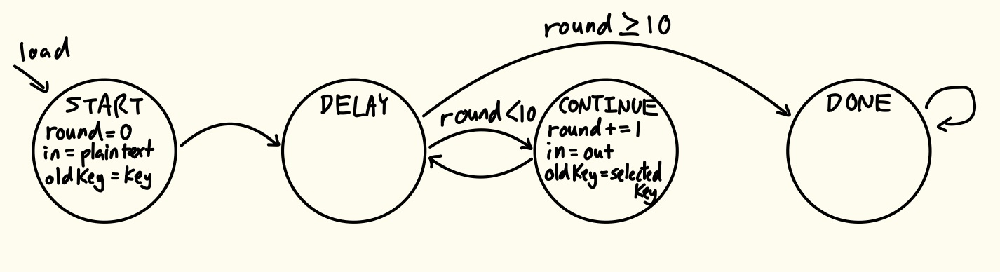
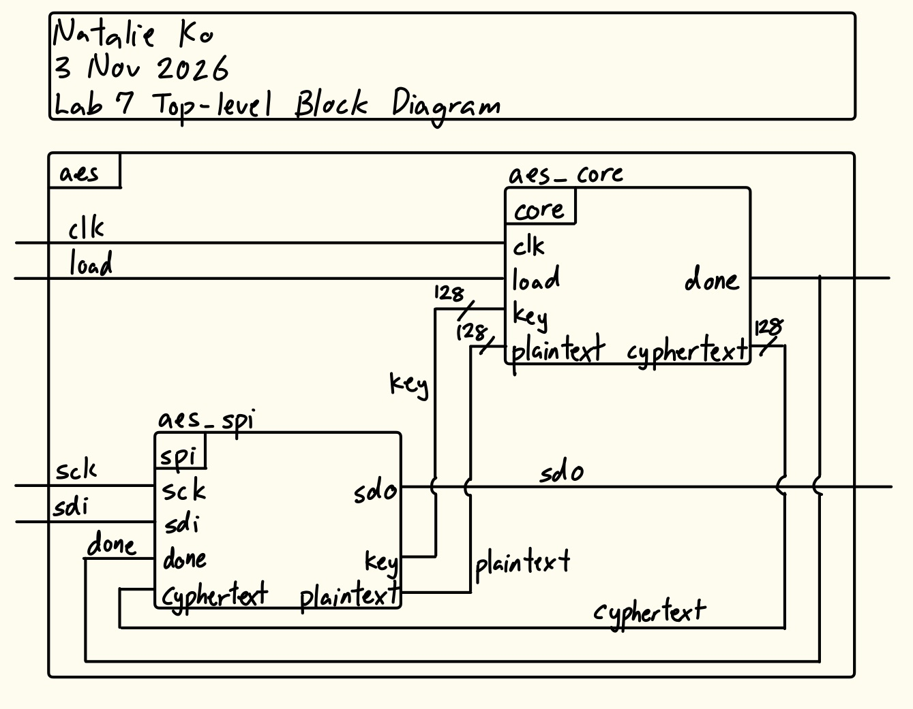
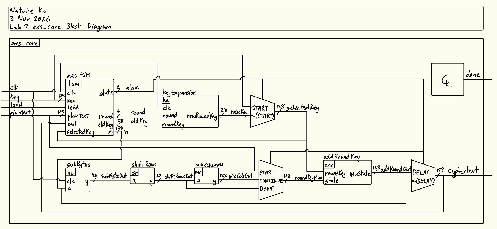
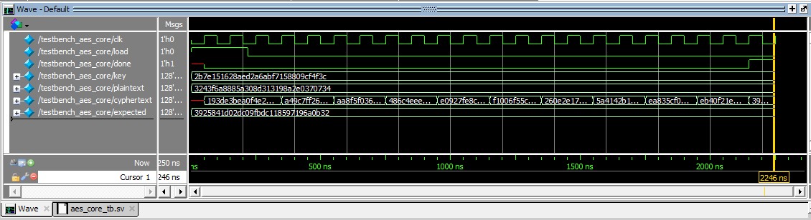
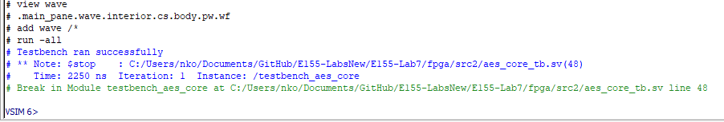
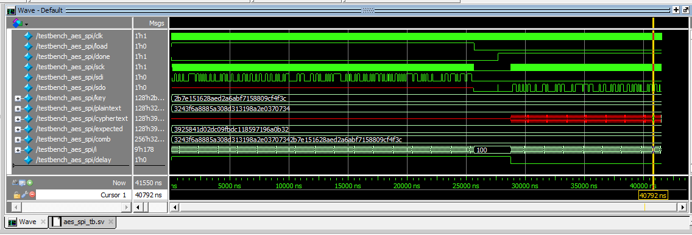
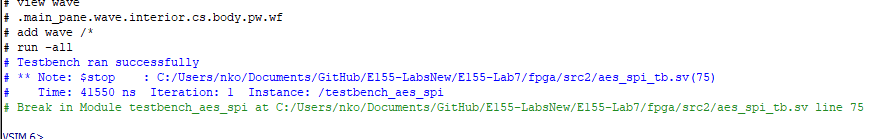
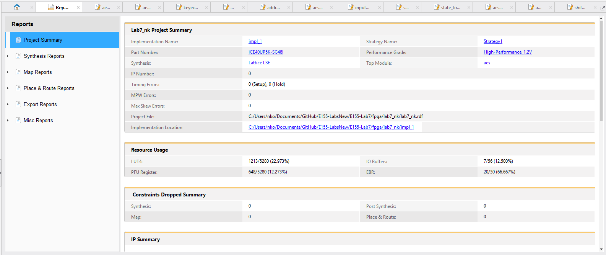

## Introduction
In this lab, a design was implemented on the FPGA to deploy the advanced encryption standars.

## Design and Testing Methodology
Because of the limited number of LUTs on the FPGA, I had to be careful with how much hardware my implementation took up. My initial idea and deployment took this to an extreme. I thought that since in subBytes I would have to apply sbox to each byte and this takes up a lot of hardware because that has to be repeated 10 times. So instead of storing all 10 copies of the result of sbox, I thought of applying it to each bit individually and only storing the end result. This ended up being A LOT of fiddling with 3D arrays, which SystemVerilog ABSOLUTELY HATED. 

So after countless hours of debugging, I discussed my approach with Jessica Li, who suggested I simplify the entire approach because although hardware was limited, it wasn't THAT limited. So I used an approach with an FSM controller and datapath. Each new computation round reuses the same hardware as in previous iterations, calling on subBytes, shiftRows, mixColumns, addRoundKey, and keyExpansion.



During the continue state, everything shifts. Round increments, the output text becomes a new input text, and the old key is the new selected key. The delay state is there to ensure everything is delayed by a clock cycle, and also so that round doesn't change while the elements in the datapath are running (otherwise I would have a cursed expanded key etc etc).

## Technical Documentation
The source code for the project can be found in the associated [GitHub repository](https://github.com/natalieko2024/E155-Labs/tree/main/E155-Lab6).

### Block Diagram
This top level block diagram showcases the architecture of the full implementation, including the SPI block to interface with the MCU.



This AES core block diagram showcases the architecture of the FPGA implementation.



## Results and Discussion
### Testbench Simulation
All testbenches passed, proving that encryption was properly carried out and the FPGA can interface with the MCU via SPI.

:::{.callout-note collapse="true"}
## Click to view aes_core module simulation waveforms

:::

:::{.callout-note collapse="true"}
## Click to view aes_core module testbench outputs

:::

:::{.callout-note collapse="true"}
## Click to view spi module simulation waveforms

:::

:::{.callout-note collapse="true"}
## Click to view spi module testbench outputs

:::

Testbenches were also written for the submodules shiftRows, mixColumns, and addRoundKey based on the example results in Appendix B of the AES manual, but are not included here because their logic is purely combinational are there aren't relevant waves that deal with timing.

### Radiant Synthesis Report
The design fits on the FPGA. From the Radiant project summary, only about 22.9% of the LUTs on the FPGA were used.



## Conclusion
The design successfully deployed the Advanced Encryption Standard and a method of communicating between FPGA and MCU over SPI protocol.

I spent 35 hours on this lab because of my CURSED INITIAL ATTEMPT AT IMPLEMENTATION.

## AI Prototype Summary
## Click to view the LLM-generated code for prompt 1 (AES manual given)
::: {.callout-note collapse="true"}
```{systemverilog}
module aes_key_expansion (
    input  logic [127:0] prev_key,   // Key from previous round
    input  logic [3:0]   round_num,  // Current round number (1 to 10)
    output logic [127:0] next_key    // Generated key for current round
);

    // Break down previous key into four 32-bit words w[0]..w[3]
    logic [31:0] w0, w1, w2, w3;
    assign w0 = prev_key[127:96];
    assign w1 = prev_key[95:64];
    assign w2 = prev_key[63:32];
    assign w3 = prev_key[31:0];

    // SubWord and RotWord interface signals
    logic [31:0] rot_word_out;
    logic [31:0] sub_word_out;

    // Instantiate RotWord module
    // RotWord([a0, a1, a2, a3]) = [a1, a2, a3, a0]
    RotWord rot_inst (
        .in  (w3),
        .out (rot_word_out)
    );

    // Instantiate SubWord module
    // SubWord applies AES S-box to each byte
    SubWord sub_inst (
        .in  (rot_word_out),
        .out (sub_word_out)
    );

    // Round Constant (Rcon) lookup table for AES-128 (rounds 1 to 10)
    // Rcon[j] = [rcon_byte, 0x00, 0x00, 0x00]
    logic [31:0] rcon;
    always_comb begin
        case (round_num)
            4'h1:    rcon = 32'h01_00_00_00;
            4'h2:    rcon = 32'h02_00_00_00;
            4'h3:    rcon = 32'h04_00_00_00;
            4'h4:    rcon = 32'h08_00_00_00;
            4'h5:    rcon = 32'h10_00_00_00;
            4'h6:    rcon = 32'h20_00_00_00;
            4'h7:    rcon = 32'h40_00_00_00;
            4'h8:    rcon = 32'h80_00_00_00;
            4'h9:    rcon = 32'h1B_00_00_00;
            4'hA:    rcon = 32'h36_00_00_00;
            default: rcon = 32'h00_00_00_00;
        endcase
    end

    // Combinational derivation of next round key words
    // w[i]   = w[i-4] ^ SubWord(RotWord(w[i-1])) ^ Rcon
    // w[i+1] = w[i-3] ^ w[i]
    // w[i+2] = w[i-2] ^ w[i+1]
    // w[i+3] = w[i-1] ^ w[i+2]
    logic [31:0] next_w0, next_w1, next_w2, next_w3;

    assign next_w0 = w0 ^ sub_word_out ^ rcon;
    assign next_w1 = w1 ^ next_w0;
    assign next_w2 = w2 ^ next_w1;
    assign next_w3 = w3 ^ next_w2;

    // Concatenate resulting 32-bit words into 128-bit next key
    assign next_key = {next_w0, next_w1, next_w2, next_w3};

endmodule
```
:::


::: {.callout-note collapse="true"}
## Click to view the LLM-generated code for prompt 2 (no AES knowledge)
```{systemverilog}
module key_expansion #(
    parameter int Nk = 4,         // Key size in 32-bit words (e.g., 4 for 128-bit, 6 for 192-bit, 8 for 256-bit)
    parameter int Nr = 10        // Number of rounds
)(
    input  logic [(4*Nk)-1:0][7:0]       key,    // Input key byte array [4*Nk bytes]
    input  logic [4*(Nr+1)-1:0][31:0]    Rcon,   // Round constants table
    output logic [4*(Nr+1)-1:0][31:0]    w       // Output expanded key words
);

    // Internal intermediate words for the unrolled sequence
    logic [31:0] temp [0 : 4*Nr + 3];

    // ------------------------------------------------------------------------
    // Loop 1: Initialize first Nk words directly from the input key bytes
    // w[i] <- key[4*i .. 4*i + 3]
    // ------------------------------------------------------------------------
    genvar i;
    generate
        for (i = 0; i < Nk; i++) begin : gen_initial_key
            assign w[i] = {key[4*i], key[4*i + 1], key[4*i + 2], key[4*i + 3]};
        end
    endgenerate

    // ------------------------------------------------------------------------
    // Loop 2: Unroll expansion step for words from index Nk to (4*Nr + 3)
    // ------------------------------------------------------------------------
    generate
        for (i = Nk; i <= 4*Nr + 3; i++) begin : gen_key_schedule
            
            // Condition 1: i mod Nk == 0 -> temp = module1(module2(w[i-1])) ^ Rcon[i/Nk]
            if (i % Nk == 0) begin : cond_mod_nk
                logic [31:0] mod2_out;
                logic [31:0] mod1_out;

                module2 inst_mod2 (
                    .in  (w[i-1]),
                    .out (mod2_out)
                );

                module1 inst_mod1 (
                    .in  (mod2_out),
                    .out (mod1_out)
                );

                assign temp[i] = mod1_out ^ Rcon[i / Nk];

            // Condition 2: Nk > 6 and i mod Nk == 4 -> temp = module1(w[i-1])
            end else if ((Nk > 6) && (i % Nk == 4)) begin : cond_mod_4
                logic [31:0] mod1_out;

                module1 inst_mod1 (
                    .in  (w[i-1]),
                    .out (mod1_out)
                );

                assign temp[i] = mod1_out;

            // Default Condition: temp = w[i-1]
            end else begin : cond_default
                assign temp[i] = w[i-1];
            end

            // w[i] <- w[i-Nk] (+) temp
            assign w[i] = w[i-Nk] ^ temp[i];

        end
    endgenerate

endmodule
```
:::

When I gave the LLM the AES manual, the code it generated was a lot more clean and readable and kind of looks like what I wrote which is a little scary. I think it could tell what the bigger picture of AES was and could write keyexpansion in a way that would fit with the other AES modules. The LLM output that didn't have AES as a constant seemed a lot more convoluted, since it parametrized everything. It used giant for loops for everything. I think since it didn't know this would be deployed with AES, it assumed both the key size and number of rounds affected almost every single line of code, whereas with the AES implementation they're fixed.

Overall both outputs are pretty good, the only errors/warnings that appeared were that the "given modules" couldn't be found, which is a non-issue. For deployment within AES, the LLM output that was given AES as context is definitely better since it's more compact and less complex.